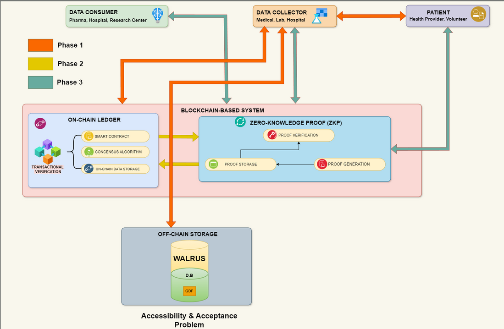

# EHR Blockchain Deployment

Deployment resources for D4Gen's privacy-preserving Electronic Health Records (EHR) platform.

The platform enables healthcare organizations to securely store, manage, and share medical records while maintaining auditable access controls. It combines Sui blockchain, Walrus decentralized storage, and Seal access control to support encrypted data workflows across hospitals, clinics, research institutions, and patients.

## Architecture

The deployment includes:

- A web application for patients, healthcare providers, and requesting organizations
- Sui Move smart contracts for record metadata, access policies, sharing, and audit events
- Decentralized encrypted storage for medical data
- Infrastructure configuration and operational documentation

No personally identifiable or protected health information is stored directly on-chain. On-chain data is limited to metadata, references, access policies, commitments, and immutable audit trails.

## Deployment Documentation

See [DEPLOYMENT.md](DEPLOYMENT.md) for deployment procedures, configuration, and operational requirements.

## Demo Application

The D4Gen platform is available at [d4gen.vuonghuuhung.com](https://d4gen.vuonghuuhung.com/sign-in).

## Project Documentation

- [Deployment guide](DEPLOYMENT.md)
- [Documentation standards](docs/STANDARD.md)
